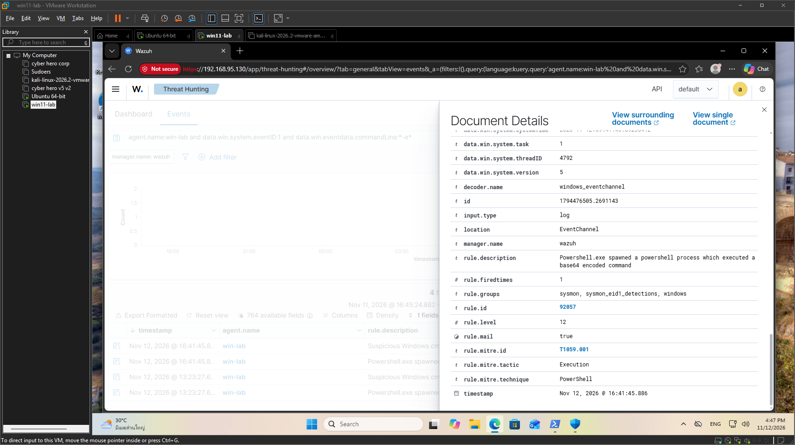
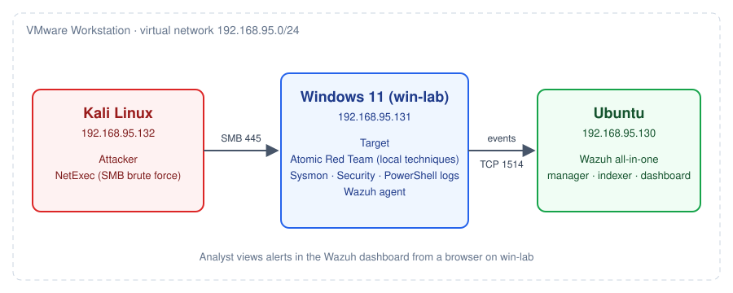

# Home SIEM Lab

A home lab that tests what a default Wazuh install detects on Windows, then closes the gaps with
custom rules.

## Overview

Many small teams run a SIEM with its default rules and assume common attacks will raise an alert.
This lab checks that assumption. I attacked a Windows 11 VM with three MITRE ATT&CK techniques,
sent its logs to Wazuh, and recorded which attacks the default ruleset alerted on, which ones it
only logged, and why. Where a real gap showed up, I wrote and tested a custom rule to close it.

**Setup.** Three VMs on an isolated VMware network: Wazuh 4.14.1 (all-in-one) on Ubuntu, a
Windows 11 target with Sysmon and the Wazuh agent, and Kali Linux as the attacker. Details are in
[Lab setup](#lab-setup).

**Method.** Each technique was run with Atomic Red Team on the Windows VM, or with NetExec from
Kali for the brute force. For every run I noted the start and end time, the Windows events it
produced, and the Wazuh rule and level that fired. A technique counts as detected when an alert
reaches level 7 or higher, the point where it would normally reach an analyst.

**Results (v1, completed Nov 16, 2026).**

- **PowerShell encoded command (T1059.001):** detected. Rule 92057 fired at level 12 from the
  process tree alone.
- **Scheduled task (T1053.005):** logged at level 4 only, even for a task that runs as SYSTEM at
  every boot. Two custom rules now raise it to level 8, and to level 12 when the task runs as
  SYSTEM.
- **Brute force over SMB (T1110):** each failed logon was logged at level 5. The 5 attempts stayed
  under the default correlation threshold of 8, so no brute-force alert fired.

**Next (v2).** Active response that blocks the brute-force source IP, file integrity monitoring
with VirusTotal enrichment, 2 to 3 Sigma rules tested against the lab logs, and an incident report
for the brute-force case.

  
  

An encoded PowerShell command as Wazuh sees it. Sysmon Event 1 (left) records only the base64
command line, and rule 92057 (right) raises a level-12 alert from that process tree alone. The
decoded script was also logged by Windows (Event 4104) but raised no alert, so it never appeared
in Wazuh.

## Skills demonstrated

| Skill | Evidence |
|---|---|
| SIEM deployment and configuration | Wazuh server and Windows agent: [Lab setup](#lab-setup), agent log channels: [config](config/) |
| Windows event logging | Sysmon 1, PowerShell 4104, Security 4625 and 4698 |
| MITRE ATT&CK mapping | [Detection results](#detection-results) |
| Adversary emulation | Atomic Red Team and NetExec: [write-ups](docs/techniques/) |
| Alert triage | Separating a real alert from framework noise (rule 91822): [T1059.001 analysis](docs/techniques/t1059-001-powershell-encoded.md#analysis) |
| Log pipeline troubleshooting | [Things I learned](#things-i-learned-along-the-way) |
| Detection engineering | Custom Wazuh rules with before/after and negative tests: [Custom rules](#custom-rules) |
| Technical documentation | This README and one write-up per technique |

## Detection results

A technique counts as **detected** when the default ruleset raises an alert at level 7 or higher.
Lower levels are stored but would not normally reach an analyst.

| Technique | ATT&CK | Event ID | Detected by default | Rule ID / level |
|---|---|---|---|---|
| PowerShell encoded command | [T1059.001](https://attack.mitre.org/techniques/T1059/001/) | Sysmon 1, 4104 | Yes | 92057 / 12 |
| Scheduled task | [T1053.005](https://attack.mitre.org/techniques/T1053/005/) | 4698, Sysmon 1 | No → Yes with a [custom rule](#custom-rules) | 60228 / 4 → 100010 / 8, 100011 / 12 |
| Brute force (SMB) | [T1110](https://attack.mitre.org/techniques/T1110/) | 4625 | No: 5 attempts, below the default threshold of 8 ([why](docs/techniques/t1110-brute-force.md#why-no-correlated-alert-fired)) | 60122 / 5 per failure |

Full write-ups with screenshots:
[T1059.001](docs/techniques/t1059-001-powershell-encoded.md),
[T1053.005](docs/techniques/t1053-005-scheduled-task.md),
[T1110](docs/techniques/t1110-brute-force.md)

## Custom rules

Rules I wrote for gaps in the default ruleset: [rules/wazuh/](rules/wazuh/)

| Gap | Rule ID / level | What it matches | Result |
|---|---|---|---|
| Scheduled task persistence ([T1053.005](docs/techniques/t1053-005-scheduled-task.md#custom-rule-v2)) | 100010 / 8 | New task that runs cmd or PowerShell at logon or boot | Atomic task raised from 60228 / 4 to 100010 / 8 |
| | 100011 / 12 | Same, running as SYSTEM | Atomic task raised from 60228 / 4 to 100011 / 12 |

Each rule was tested by re-running the same attack, and against a benign task
(`notepad.exe` at logon) that should not match. It did not.

## Things I learned along the way

Each point comes from a specific result in this lab.

- **An empty search is not a missed event.** In T1059.001, searching Threat Hunting for the decoded
  script returned nothing, but the exported PowerShell log on win-lab had it (Event 4104). Threat
  Hunting shows alerts at level 3 or above, not raw logs.
  [T1059.001 analysis](docs/techniques/t1059-001-powershell-encoded.md#analysis)
- **Script Block Logging needs both sides.** Event 4104 reached Wazuh only after the policy was
  enabled on win-lab ([`enable-logging.ps1`](config/enable-logging.ps1)) and the channel was added
  to the agent ([`agent-localfile.xml`](config/agent-localfile.xml)).
- **Atomic Red Team makes its own alerts.** Rule 91822 fired at level 12 on the framework's wrapper
  script `Invoke-ExecuteCommand.ps1`, not on the technique. The `path` field separates the two.
  [T1059.001 analysis](docs/techniques/t1059-001-powershell-encoded.md#analysis)
- **"No alert" can mean "below the threshold".** The 5-attempt brute force stayed under rule 60204,
  which needs 8 failures from one IP in 240 seconds. Check the ruleset before calling something a
  gap. [T1110](docs/techniques/t1110-brute-force.md#why-no-correlated-alert-fired)
- **Default ATT&CK tags need checking.** Rule 60122, which fired on every failed logon in the
  brute-force test, is tagged T1531 instead of T1110.
  [T1110 analysis](docs/techniques/t1110-brute-force.md#analysis)
- **Check how a field is stored before writing a rule.** Event 4698 stores the task XML escaped
  (`&lt;Command&gt;`), so the custom T1053.005 rules match `Command.gt;`. A pattern on `<Command>`
  would never match and would fail silently.
  [T1053.005 rule design](docs/techniques/t1053-005-scheduled-task.md#design)

## Lab setup

| Machine | Role | IP |
|---|---|---|
| Ubuntu 24.04 LTS | Wazuh 4.14.1 all-in-one | 192.168.95.130 |
| Windows 11 (hostname `win-lab`, VM `win11-lab`) | Target with Sysmon and the Wazuh agent | 192.168.95.131 |
| Kali Linux | Attacker for brute force | 192.168.95.132 |

All machines run in VMware Workstation on an isolated network.

Changes from the default configuration:

- Sysmon installed with [SwiftOnSecurity sysmon-config](https://github.com/SwiftOnSecurity/sysmon-config)
- Sysmon and PowerShell/Operational channels added to the agent: [`config/agent-localfile.xml`](config/agent-localfile.xml)
- Script Block Logging enabled through the registry: [`config/enable-logging.ps1`](config/enable-logging.ps1)
- `Other Object Access Events` audit policy enabled to log scheduled task creation (4698)

## Roadmap

- [x] T1059.001 PowerShell encoded command
- [x] T1053.005 Scheduled task
- [x] T1110 Brute force from Kali
- [x] Custom Wazuh rule for a detection gap, with before/after testing ([T1053.005](docs/techniques/t1053-005-scheduled-task.md#custom-rule-v2))
- [ ] Active response that blocks the brute-force source IP
- [ ] File integrity monitoring with VirusTotal enrichment
- [ ] 2 to 3 Sigma rules tested against lab logs
- [ ] Incident report for the brute-force case

## Tools

[Wazuh](https://wazuh.com), [Sysmon](https://learn.microsoft.com/sysinternals/downloads/sysmon),
[Atomic Red Team](https://github.com/redcanaryco/atomic-red-team), Kali Linux,
[NetExec](https://github.com/Pennyw0rth/NetExec), VMware Workstation

## License

MIT. See [LICENSE](LICENSE).
