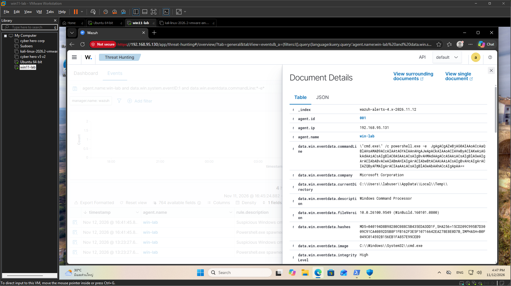

# Home SIEM Lab

Testing what a default Wazuh install detects on Windows.

  
  

An encoded PowerShell command as Wazuh sees it. Sysmon Event 1 (left) records only the base64
command line, and rule 92057 (right) raises a level-12 alert from that process tree alone.
The decoded script was also logged by Windows (Event 4104), but no rule matched it, so it never
reached the Wazuh index.

This lab runs MITRE ATT&CK techniques against a Windows 11 VM and records which ones the default
Wazuh ruleset detects, which ones it logs without alerting, and which ones it misses.

v1 (3 techniques) completed on Nov 16, 2026. v2 adds two techniques, custom rules and Sigma rules.

## Skills demonstrated

| Skill | Evidence |
|---|---|
| SIEM deployment and configuration | Wazuh server, Windows agent, log channel config: [config](config/) |
| Windows event logging | Sysmon 1, PowerShell 4104, Security 4625 and 4698 |
| MITRE ATT&CK mapping | [Detection results](#detection-results) |
| Adversary emulation | Atomic Red Team and NetExec: [write-ups](docs/techniques/) |
| Alert triage | Interpreting rule IDs and severity levels |
| Log pipeline troubleshooting | [Things I learned](#things-i-learned-along-the-way) |
| Detection engineering | Custom Wazuh rules with before/after and negative tests: [Custom rules](#custom-rules) |
| Technical documentation | This README and one write-up per technique |

## Detection results

A technique counts as **detected** when the default ruleset raises an alert at level 7 or higher.
Lower levels are stored but would not normally reach an analyst.

| Technique | ATT&CK | Event ID | Detected by default | Rule ID / level |
|---|---|---|---|---|
| PowerShell encoded command | [T1059.001](https://attack.mitre.org/techniques/T1059/001/) | Sysmon 1, 4104 | Yes | 92057 / 12 |
| Scheduled task | [T1053.005](https://attack.mitre.org/techniques/T1053/005/) | 4698, Sysmon 1 | No (logged only) | 60228 / 4, 92032 / 3 |
| Brute force (SMB) | [T1110](https://attack.mitre.org/techniques/T1110/) | 4625 | No (logged only) | 60122 / 5 per failure |

Full write-ups with screenshots:
[T1059.001](docs/techniques/t1059-001-powershell-encoded.md),
[T1053.005](docs/techniques/t1053-005-scheduled-task.md),
[T1110](docs/techniques/t1110-brute-force.md)

## Custom rules

Rules I wrote for gaps in the default ruleset: [rules/wazuh/](rules/wazuh/)

| Gap | Rule ID / level | What it matches | Result |
|---|---|---|---|
| Scheduled task persistence ([T1053.005](docs/techniques/t1053-005-scheduled-task.md#custom-rule-v2)) | 100010 / 8 | New task that runs cmd or PowerShell at logon or boot | Atomic task raised from 60228 / 4 to 100010 / 8 |
| | 100011 / 12 | Same, running as SYSTEM | Atomic task raised from 60228 / 4 to 100011 / 12 |

Each rule was tested by re-running the same attack, and against a benign task
(`notepad.exe` at logon) that should not match. It did not.

## Things I learned along the way

- **Threat Hunting shows alerts, not raw logs.** Events below level 3 never reach the index, so an
  empty search does not mean the agent missed the event.
- **Script Block Logging needs both sides.** Windows writes 4104 only after the policy is enabled,
  and Wazuh reads it only after the channel is added to `ossec.conf`.
- **Most 4104 events in a test are Atomic Red Team itself.** Filter by the `path` field to separate
  the framework from the payload.
- **Default ATT&CK tags need checking.** Rule 60122 (failed logon) is tagged T1531, not T1110.
- **Check how a field is stored before writing a rule.** Event 4698 keeps the task XML escaped
  (`&lt;Command&gt;`), so a pattern on `<Command>` would fail silently.

Details for each are in the [write-ups](docs/techniques/).

## Lab setup

| Machine | Role | IP |
|---|---|---|
| Ubuntu 24.04 LTS | Wazuh 4.14.1 all-in-one | 192.168.95.130 |
| Windows 11 (`win-lab`) | Target with Sysmon and the Wazuh agent | 192.168.95.131 |
| Kali Linux | Attacker for brute force | 192.168.95.132 |

All machines run in VMware Workstation on an isolated network.

Changes from the default configuration:

- Sysmon installed with [SwiftOnSecurity sysmon-config](https://github.com/SwiftOnSecurity/sysmon-config)
- Sysmon and PowerShell/Operational channels added to the agent: [`config/agent-localfile.xml`](config/agent-localfile.xml)
- Script Block Logging enabled through the registry: [`config/enable-logging.ps1`](config/enable-logging.ps1)
- `Other Object Access Events` audit policy enabled to log scheduled task creation (4698)

## Roadmap

- [x] T1059.001 PowerShell encoded command
- [x] T1053.005 Scheduled task
- [x] T1110 Brute force from Kali
- [ ] T1136.001 Local account creation and T1070.001 Event log clearing
- [x] Custom Wazuh rule for a detection gap, with before/after testing ([T1053.005](docs/techniques/t1053-005-scheduled-task.md#custom-rule-v2))
- [ ] 2 to 3 Sigma rules tested against lab logs
- [ ] Incident report

## Tools

[Wazuh](https://wazuh.com), [Sysmon](https://learn.microsoft.com/sysinternals/downloads/sysmon),
[Atomic Red Team](https://github.com/redcanaryco/atomic-red-team), Kali Linux,
[NetExec](https://github.com/Pennyw0rth/NetExec), VMware Workstation

## License

MIT. See [LICENSE](LICENSE).
