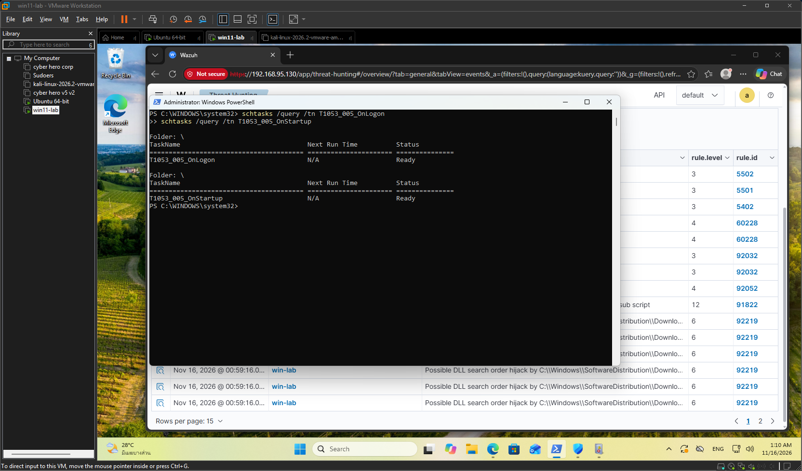

# T1053.005 — Scheduled task

**Result: not detected** (logged at level 4 only, below the level-7 threshold used in this lab).
One of the two tasks runs as SYSTEM at every boot.

## What was run

Atomic Red Team test **T1053.005-1 "Scheduled Task Startup Script"** on win-lab,
2026-11-16, 00:59:36 to 00:59:37 (UTC+7).

```powershell
Invoke-AtomicTest T1053.005 -TestNumbers 1
```

The test runs two commands:

```bat
schtasks /create /tn "T1053_005_OnLogon"   /sc onlogon /tr "cmd.exe /c calc.exe"
schtasks /create /tn "T1053_005_OnStartup" /sc onstart /ru system /tr "cmd.exe /c calc.exe"
```

`calc.exe` stands in for a malicious payload. Both tasks were confirmed with `schtasks /query`
and removed afterwards with `-Cleanup`.




## What Windows logged

| Source | Event | What it shows |
|---|---|---|
| Security | 4698 ×2 (scheduled task created) | Task names `\T1053_005_OnLogon` and `\T1053_005_OnStartup`, full task XML, creating account |
| Sysmon | 1 (process creation) | `schtasks.exe` with the full `/create` command line |

Event 4698 is only written after enabling the `Other Object Access Events` audit subcategory
([config/enable-logging.ps1](../../config/enable-logging.ps1)).

## What Wazuh alerted on

| Rule | Level | Description | Source |
|---|---|---|---|
| 60228 | 4 | A scheduled task was created | 4698, once per task |
| 92052 | 4 | Windows command prompt started by an abnormal process | Sysmon 1 |
| 92032 | 3 | Suspicious Windows cmd shell execution | Sysmon 1 (`schtasks.exe`) |


## Analysis

- **Both log sources saw it and neither raised it.** The highest alert was level 4.
- **The SYSTEM task is treated like any other task.** Rule 60228 does not look at the
  run-as account or the trigger, so a boot-time task running as SYSTEM, a common persistence
  method, gets the same level as a user creating a reminder.
- Wazuh maps 60228 to T1053 correctly.

## Detection gap for v2

A custom rule on 4698 where the task runs as SYSTEM (or `/ru system` appears in the Sysmon
command line), at level 10 or higher.
