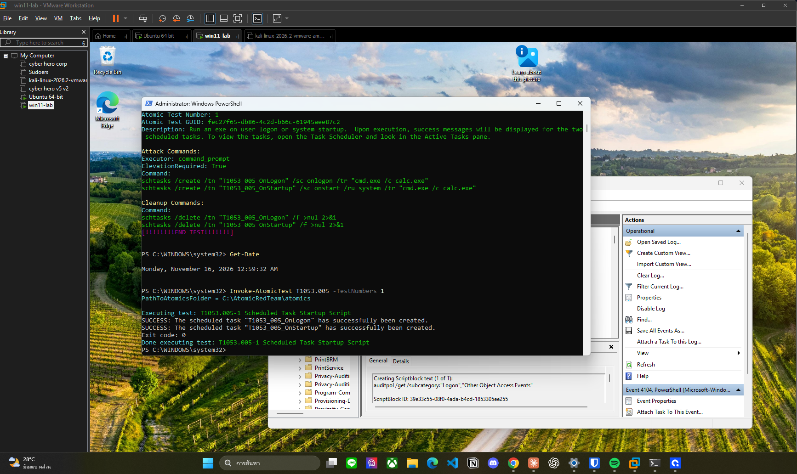
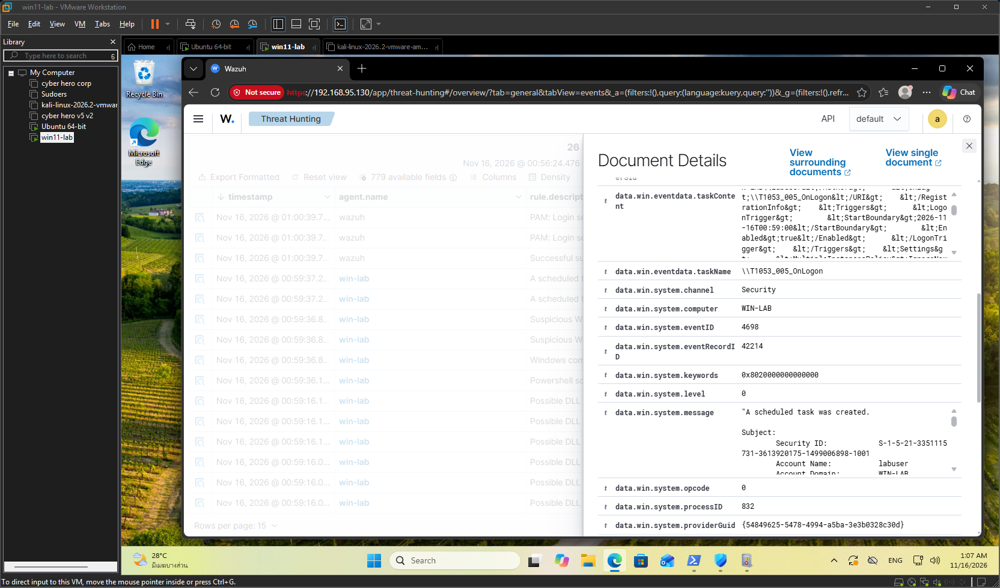
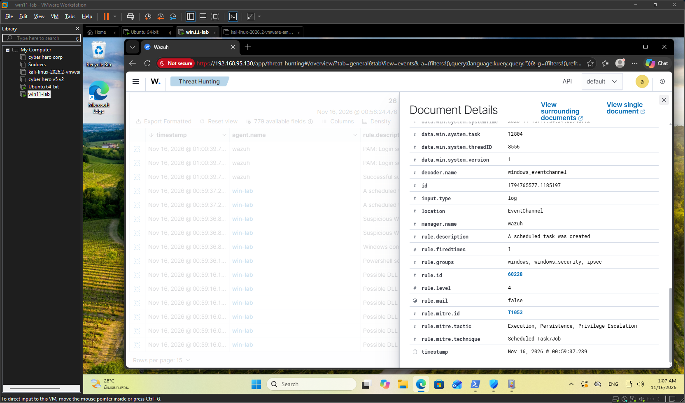
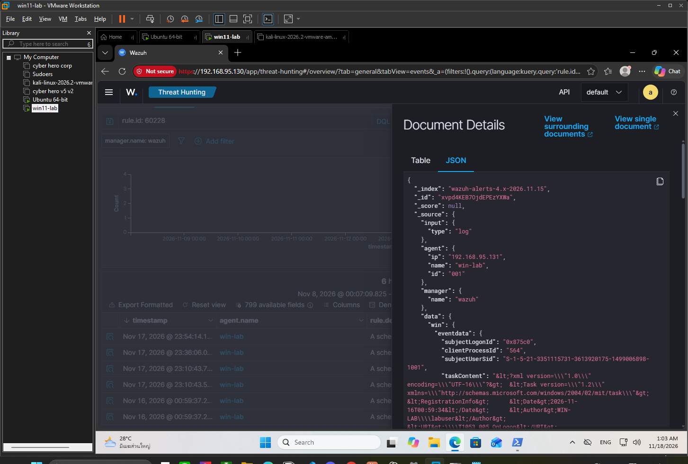
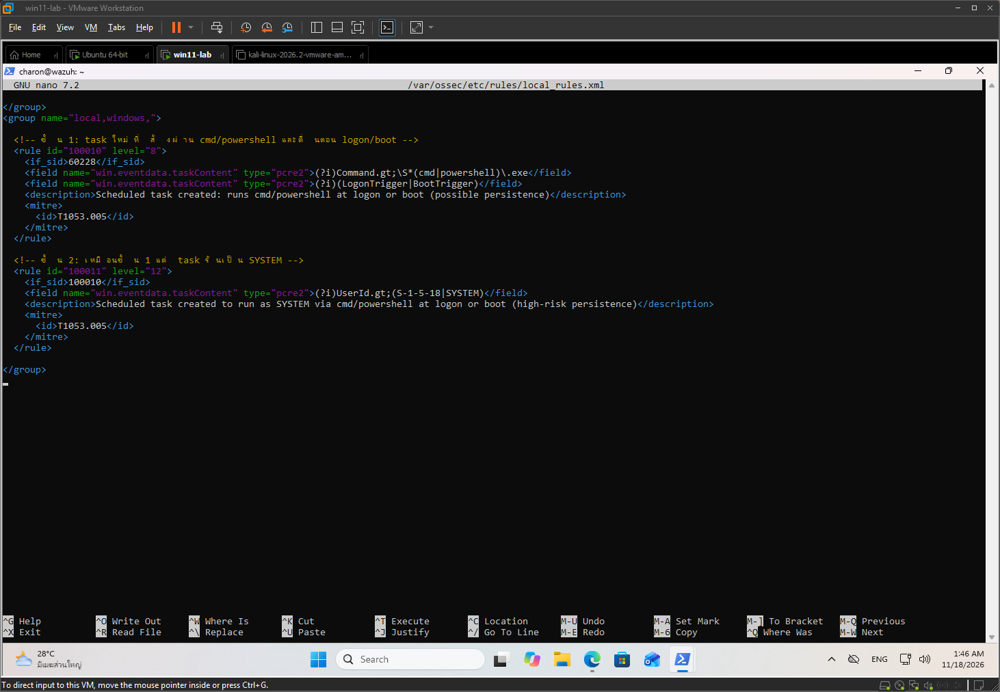
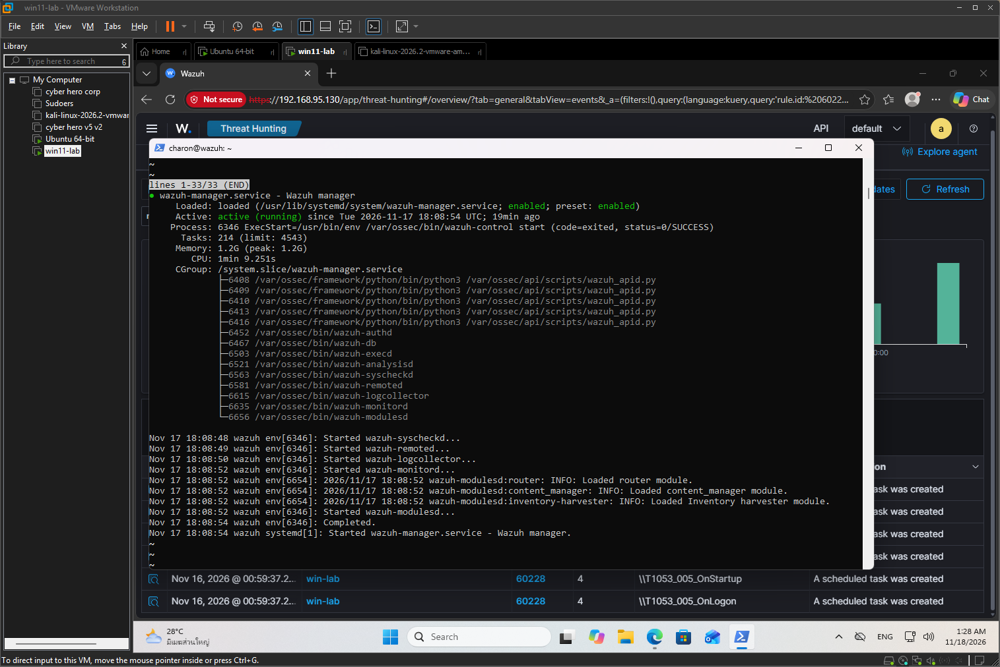
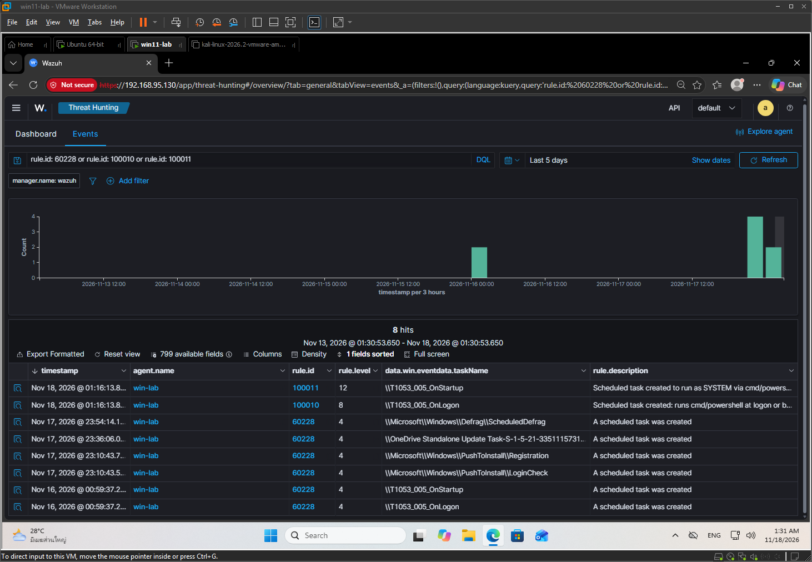
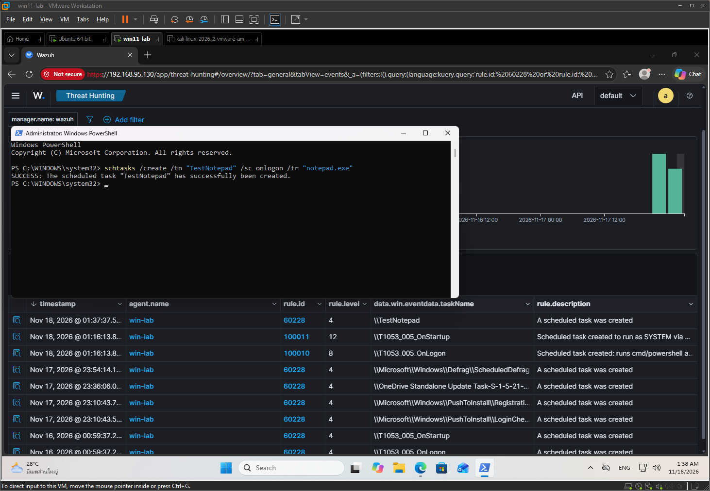

# T1053.005 — Scheduled task

**Result: not detected** (logged at level 4 only, below the level-7 threshold used in this lab).
One of the two tasks runs as SYSTEM at every boot.

## What was run

Atomic Red Team test **T1053.005-1 "Scheduled Task Startup Script"** on win-lab,
2026-11-16, 00:59:36 to 00:59:37 (UTC+7).

```powershell
Invoke-AtomicTest T1053.005 -TestNumbers 1
```

The test runs two commands:

```bat
schtasks /create /tn "T1053_005_OnLogon"   /sc onlogon /tr "cmd.exe /c calc.exe"
schtasks /create /tn "T1053_005_OnStartup" /sc onstart /ru system /tr "cmd.exe /c calc.exe"
```

`calc.exe` stands in for a malicious payload. Both tasks were confirmed with `schtasks /query`
and removed afterwards with `-Cleanup`.




## What Windows logged

| Source | Event | What it shows |
|---|---|---|
| Security | 4698 ×2 (scheduled task created) | Task names `\T1053_005_OnLogon` and `\T1053_005_OnStartup`, full task XML, creating account |
| Sysmon | 1 (process creation) | `schtasks.exe` with the full `/create` command line |

Event 4698 is only written after enabling the `Other Object Access Events` audit subcategory
([config/enable-logging.ps1](../../config/enable-logging.ps1)).

## What Wazuh alerted on

| Rule | Level | Description | Source |
|---|---|---|---|
| 60228 | 4 | A scheduled task was created | 4698, once per task |
| 92052 | 4 | Windows command prompt started by an abnormal process | Sysmon 1 |
| 92032 | 3 | Suspicious Windows cmd shell execution | Sysmon 1 (`schtasks.exe`) |





## Analysis

- **Both log sources saw it and neither raised it.** The highest alert was level 4.
- **The SYSTEM task is treated like any other task.** Rule 60228 does not look at the
  run-as account or the trigger, so a boot-time task running as SYSTEM, a common persistence
  method, gets the same level as a user creating a reminder.
- Wazuh maps 60228 to T1053 correctly.

## Custom rule (v2)

**Result: detected** after adding two custom rules: [rules/wazuh/t1053-005-scheduled-task.xml](../../rules/wazuh/t1053-005-scheduled-task.xml).

### Design

Running as SYSTEM alone is not a useful signal: Windows' own tasks do it. A 4698 alert on win-lab
the same day was `\Microsoft\Windows\Defrag\ScheduledDefrag`, which runs
`%windir%\system32\defrag.exe` as SYSTEM with `HighestAvailable`. What separates the Atomic tasks is
**what they run** (a command interpreter) and **when they start** (logon or boot).

| Rule | Level | Builds on | Condition |
|---|---|---|---|
| 100010 | 8 | 60228 | Task command is `cmd.exe` or `powershell.exe`, and the trigger is logon or boot |
| 100011 | 12 | 100010 | Same, and the task runs as SYSTEM (`S-1-5-18`) |

Event 4698 stores the task XML escaped inside `win.eventdata.taskContent`
(`&lt;Command&gt;cmd.exe`), so the patterns match `Command.gt;` rather than `<Command>`.
A pattern written against the unescaped XML would never match and would fail silently.





### Test

Rules loaded with a manager restart, then the same Atomic test was run again on 2026-11-18 at
01:16 (UTC+7).



| Task | Before (2026-11-16) | After (2026-11-18) |
|---|---|---|
| `\T1053_005_OnLogon` (labuser) | 60228 / 4 | **100010 / 8** |
| `\T1053_005_OnStartup` (SYSTEM) | 60228 / 4 | **100011 / 12** |



Negative test: a logon-triggered task that runs `notepad.exe` directly
(`schtasks /create /tn "TestNotepad" /sc onlogon /tr "notepad.exe"`) stayed at 60228 / 4.



### Limits

- **Renamed interpreter.** A task that runs a copy of `powershell.exe` under another name, or runs
  the payload directly without cmd or PowerShell, does not match. 4698 only records the command
  text; Sysmon 1 (`OriginalFileName`) at execution time is the place to catch that.
- **False positives not measured.** The lab has few legitimate tasks, so level 8 and 12 are
  starting points, not tuned values.
