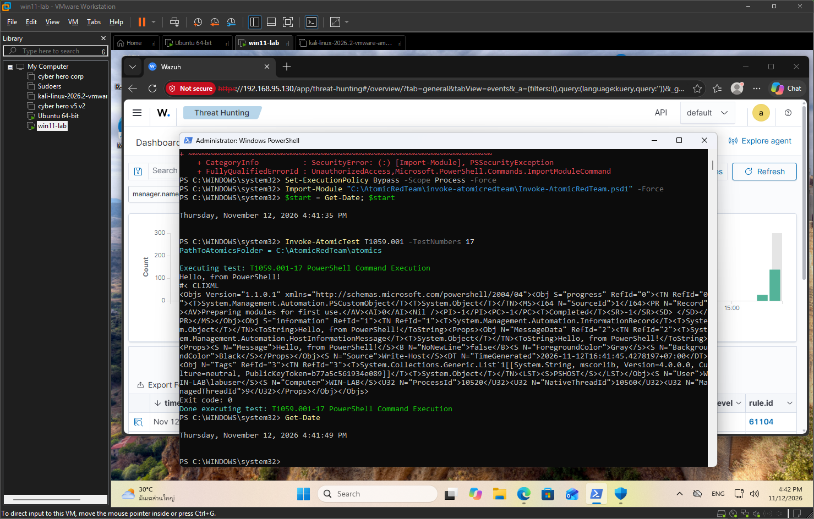
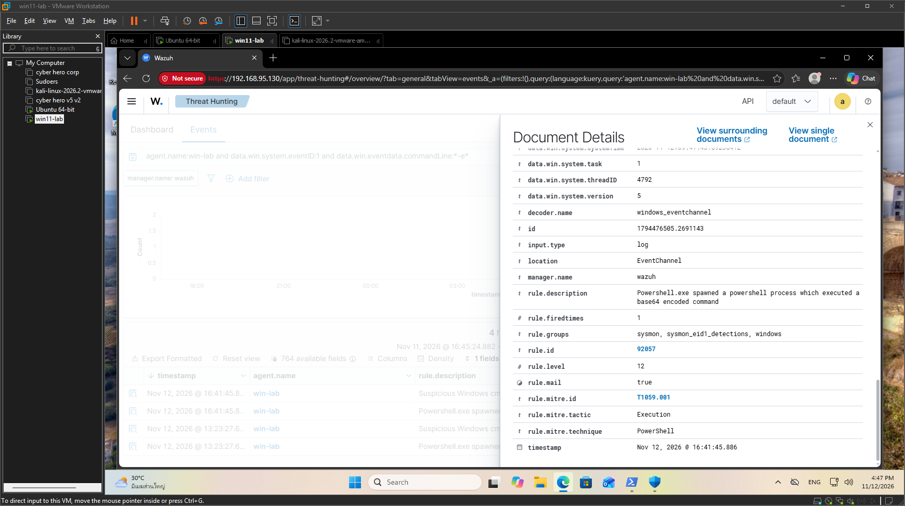
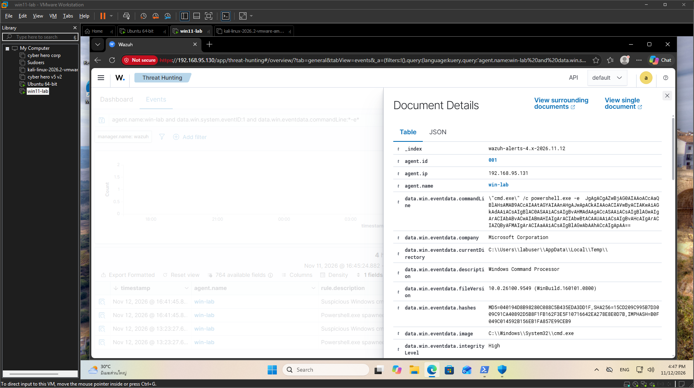

# T1059.001 — PowerShell encoded command

**Result: detected.** Rule 92057 fired at level 12 from the Sysmon process-creation event.
The decoded script was logged by Windows but never reached the Wazuh index.

## What was run

Atomic Red Team test **T1059.001-17 "PowerShell Command Execution"** on win-lab,
2026-11-12, 16:41:35 to 16:41:49 (UTC+7).

```powershell
Invoke-AtomicTest T1059.001 -TestNumbers 17
```

The test starts `cmd.exe /c powershell.exe -e <base64>`. The base64 decodes to:

```powershell
Write-Host 'Hello, from PowerShell!'
```

An earlier run at 13:23 the same day produced the same Sysmon events.



## What Windows logged

| Source | Event | What it shows |
|---|---|---|
| Sysmon | 1 (process creation) | `cmd.exe /c powershell.exe -e JgAgACgAZwBj...` with parent `powershell.exe`, user `WIN-LAB\labuser`, integrity High |
| PowerShell/Operational | 4104 (script block) | The decoded script `Write-Host 'Hello, from PowerShell!'` (record 436), plus many blocks from the Atomic framework itself |

## What Wazuh alerted on

| Rule | Level | Description | Source |
|---|---|---|---|
| **92057** | **12** | Powershell.exe spawned a powershell process which executed a base64 encoded command | Sysmon 1 |
| 91822 | 12 | Powershell script used "Invoke-command" cmdlet to execute sub script | 4104 from the Atomic wrapper `Invoke-ExecuteCommand.ps1` |
| 92032 | 3 | Suspicious Windows cmd shell execution | Sysmon 1 |





## Analysis

- **The detection comes from the process tree, not the payload.** Rule 92057 matches PowerShell
  starting a child PowerShell with `-e`. It never sees the decoded script.
- **The decoded 4104 event was dropped.** Searching the Wazuh index for
  `data.win.eventdata.scriptBlockText:*Hello*` returned nothing. The exported
  `PowerShell/Operational` log does contain it, so the agent collected it and the manager discarded
  it because no rule matched `Write-Host`. A payload that avoids the `-e` pattern and contains no
  suspicious keywords would go unnoticed the same way.
- **Rule 91822 at level 12 is framework noise.** It fired on Atomic Red Team's own wrapper script,
  not on the technique. In a real environment, an alert like this would need checking against the
  script `path` before escalating.

## Detection gap for v2

Alert on any 4104 event whose script block was launched from an encoded command, or index 4104
events regardless of rule match so the decoded payload is searchable.
