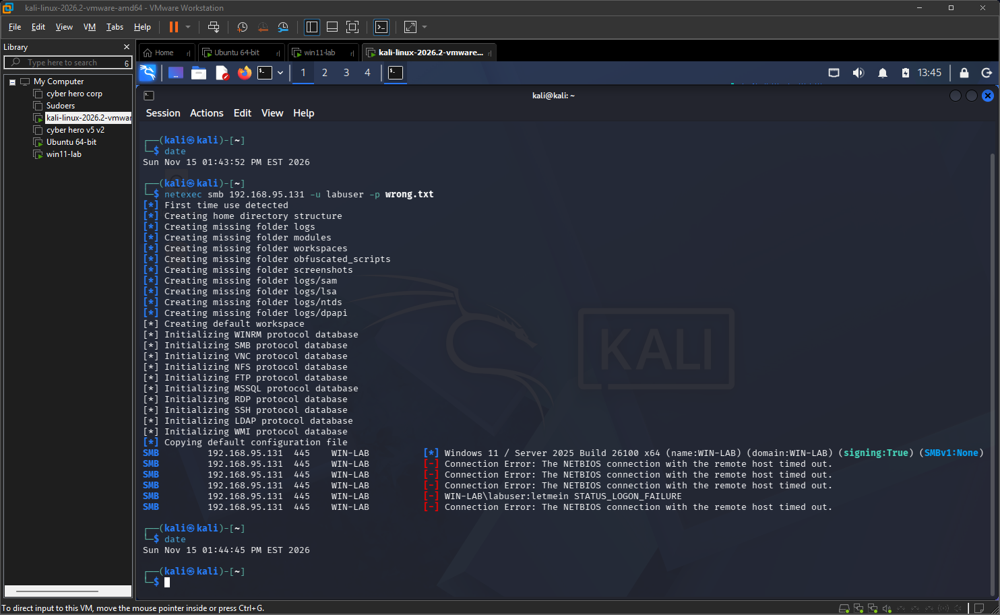
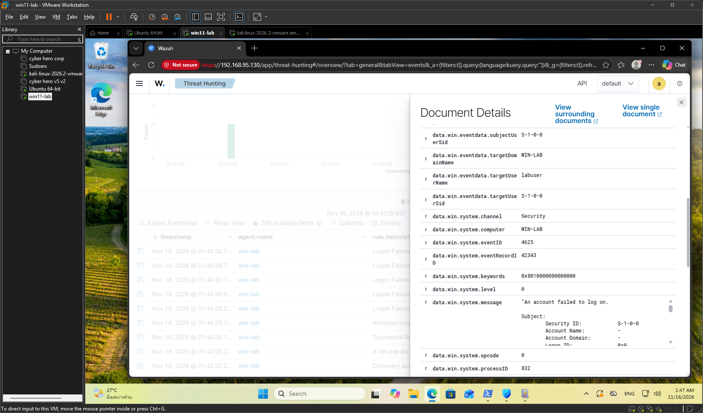
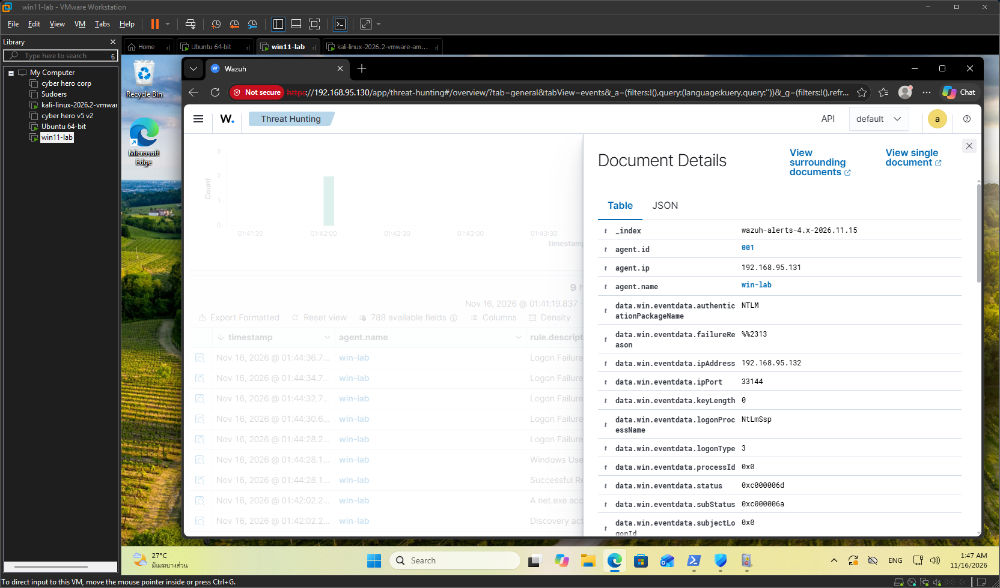
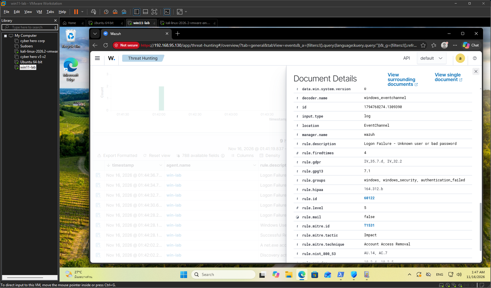

# T1110 — Brute force over SMB

**Result: not detected** (each failure logged at level 5; no alert for the pattern).

## What was run

From Kali (192.168.95.132) against win-lab over SMB (TCP 445),
2026-11-16, 01:44:28 to 01:44:36 (UTC+7). The Kali clock is set to EST, so the screenshots show
01:43 to 01:44 PM on Nov 15.

```bash
printf 'abc123\npassword\nqwerty\nletmein\nadmin1\n' > wrong.txt
netexec smb 192.168.95.131 -u labuser -p wrong.txt
```

Five wrong passwords for an existing local account. The list was kept under 10 because
Windows 11 locks an account after 10 failed attempts by default.



NetExec reported one `STATUS_LOGON_FAILURE` and four NetBIOS timeouts, but Windows logged all
five attempts. The timeouts are on the client side only: the replies were slow to arrive, but each
attempt reached Windows and was recorded.

## What Windows logged

| Source | Event | What it shows |
|---|---|---|
| Security | 4625 ×5 (logon failed) | Logon type 3 (network), NTLM, target `labuser`, source IP 192.168.95.132, sub-status `0xC000006A` (wrong password for an existing account) |

## What Wazuh alerted on

| Rule | Level | Description | Notes |
|---|---|---|---|
| 60122 | 5 | Logon Failure - Unknown user or bad password | Once per failure; tagged T1531 |
| 92652 | 6 | Successful Remote Logon Detected - ANONYMOUS LOGON - NTLM | NetExec's anonymous session to read host information |







## Analysis

- **Every failure is visible, the attack is not.** Five failures in eight seconds from one IP
  produced five separate level-5 alerts. No correlated "multiple failures" alert fired at this
  volume.
- **The ATT&CK tag is wrong.** Rule 60122 is mapped to T1531 Account Access Removal, not T1110.
  Default mappings need checking before they are used in reports.
- **The anonymous logon (92652) is the earliest sign.** It fired before the first wrong password,
  because NetExec opens a null session to fingerprint the host.

## Detection gap for v2

A frequency rule: five or more 4625 events for the same account from the same source IP within
60 seconds raises one alert at level 10.
